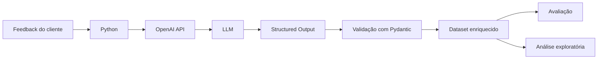

# AI Customer Intelligence

**Em 30 segundos:** pipeline Python que transforma feedbacks sintéticos de serviços financeiros em categoria, assunto, sentimento, urgência, resumo, possível causa e ação sugerida. Os dados estruturados são explorados em um notebook. Em 120 exemplos gerados para este projeto, 119 categorias e 118 assuntos coincidiram com os rótulos usados na geração. Esses números **não são estimativa de desempenho em clientes reais**.

| Onde olhar | O que demonstra |
|---|---|
| [Pipeline](pipeline.py) e [schema](models.py) | Retomada por ID, resposta estruturada e validação de categoria × assunto |
| [Avaliação](evaluation.py) | Comparação por ID, incluindo falhas e ausências no denominador |
| [Notebook](01_customer_feedback_analysis.ipynb) | Distribuições e análise exploratória reproduzível |

Para conhecer o funcionamento sem usar uma chave de API, execute a avaliação e abra o notebook: os resultados já estão em `data/`. O pipeline chama a API somente para IDs ainda não concluídos; uma nova execução com estes 120 resultados não gasta tokens.

Projeto de Customer Intelligence que utiliza uma LLM para transformar feedbacks escritos por clientes em dados estruturados e mais fáceis de analisar.

A ideia surgiu a partir de um problema simples: uma empresa pode receber centenas ou milhares de comentários de clientes, mas boa parte dessas informações chega em formato de texto. Ler e classificar tudo manualmente dificulta identificar quais problemas aparecem, quais precisam de mais atenção e como os clientes estão reagindo.

Neste projeto, desenvolvi um pipeline em Python que envia cada feedback para uma LLM e retorna uma análise estruturada contendo categoria, assunto, sentimento, urgência, resumo, possível causa e ação recomendada.

---

## Objetivo

O objetivo principal é transformar textos como:

> "Não consigo fazer pix, aparece erro toda vez que confirmo."

em informações estruturadas:

| Campo | Resultado |
|---|---|
| Categoria | Pix |
| Assunto | Erro ao realizar Pix |
| Sentimento | Negativo |
| Urgência | Alta |
| Resumo | Erro ao confirmar PIX, transferência não é concluída. |
| Possível causa | Não é possível determinar a causa específica com as informações fornecidas. |
| Ação recomendada | Contatar o suporte e informar o erro e o horário da tentativa. |

Com os feedbacks estruturados, fica muito mais simples utilizar ferramentas como Pandas para analisar os dados e encontrar padrões.

---

## Como o projeto funciona

O fluxo principal da aplicação é:



O texto original é enviado para a LLM junto com as regras de classificação. A resposta não é recebida como texto livre: ela precisa seguir a estrutura definida no projeto.

O Pydantic é utilizado para validar essa resposta antes que ela seja adicionada ao dataset final.

---

## Taxonomia

Antes de construir o pipeline, foi definida uma taxonomia para limitar as classificações possíveis e manter os resultados consistentes.

As categorias utilizadas são:

- Pix
- Cartão de crédito
- Aplicativo
- Boleto
- Empréstimo
- Atendimento

Cada categoria possui seus próprios assuntos.

### Pix

- Estorno de Pix
- Pix não reconhecido
- Pix não recebido
- Problema com chave Pix
- Erro ao realizar Pix
- Pix em processamento

### Cartão de crédito

- Cartão bloqueado
- Limite do cartão
- Compra bloqueada
- Compra não reconhecida
- Cobrança duplicada
- Problema com fatura

### Aplicativo

- Problema no login
- Problema com documento
- Problema com reconhecimento facial
- Erro no aplicativo
- Dúvida sobre o aplicativo

### Boleto

- Pagamento não reconhecido
- Erro ao pagar
- Boleto vencido
- Pagamento duplicado
- Cobrança incorreta

### Empréstimo

- Parcela incorreta
- Cobrança indevida
- Dificuldade na contratação
- Problema na quitação
- Dúvida sobre juros
- Renegociação

### Atendimento

- Dificuldade para ser atendido
- Atendimento não resolveu
- Reclamação de atendente
- Elogio ao atendimento

Além de categoria e assunto, a LLM também classifica:

**Sentimento**

`muito_negativo` → `negativo` → `neutro` → `positivo` → `muito_positivo`

**Urgência**

`baixa` → `media` → `alta` → `critica`

Uma decisão importante durante o desenvolvimento foi separar sentimento de urgência.

Um cliente pode escrever uma reclamação demonstrando bastante insatisfação, mas isso não significa necessariamente que o problema seja crítico. Da mesma forma, uma mensagem relativamente neutra pode descrever uma situação que precisa ser tratada rapidamente.

---

## Dataset

O projeto utiliza um dataset sintético com **120 feedbacks** relacionados a serviços financeiros.

Os textos foram criados com variações de escrita, nível de detalhe e contexto para evitar que todos os exemplos tivessem exatamente o mesmo formato.

Durante a geração, também foram definidas categorias e assuntos de referência. Esses rótulos foram posteriormente utilizados para avaliar as classificações realizadas pela LLM.

Os dados estão disponíveis na pasta `data/`.

| Arquivo | Função |
|---|---|
| `customer_feedback.csv` | Feedbacks utilizados pelo pipeline |
| `generation_metadata.csv` | Categoria e assunto utilizados na geração |
| `feedback_enriched.csv` | Resultado completo após processamento pela LLM |
| `evaluation_results.csv` | Comparação entre os valores esperados e classificados |

Como o dataset é sintético, ele não representa a distribuição real de reclamações de clientes de uma instituição financeira. Seu objetivo é permitir o desenvolvimento e teste do pipeline.

Os rótulos de referência foram atribuídos durante a geração dos textos, e não por anotadores independentes. Em casos ambíguos, um desacordo com esse rótulo não prova que a classificação do modelo seja incorreta. Não há validação externa neste repositório.

---

## Estrutura da resposta da LLM

Cada feedback é transformado em um objeto com os seguintes campos:

```text
categoria
assunto
sentimento
urgencia
resumo
possivel_causa
acao_recomendada
```

Essa estrutura é definida utilizando Pydantic.

Além de verificar os tipos dos dados, o projeto valida a relação entre categoria e assunto.

Por exemplo:

```text
categoria = pix
assunto = erro_ao_realizar_pix
```

é válido.

Enquanto:

```text
categoria = boleto
assunto = erro_ao_realizar_pix
```

é rejeitado.

Isso evita que uma resposta estruturalmente válida da LLM gere combinações que não existem na taxonomia do projeto.

---

## Pipeline

O processamento principal acontece em `pipeline.py`.

Para cada feedback:

1. o texto é lido do dataset;
2. `analyzer.py` envia o conteúdo para a API;
3. a LLM realiza a classificação;
4. a resposta é convertida para o modelo `AnaliseFeedback`;
5. o Pydantic valida os campos;
6. o resultado é adicionado ao dataset enriquecido;
7. o arquivo é salvo novamente.

O pipeline também possui um mecanismo simples de retomada.

Se o processamento for interrompido depois de parte dos feedbacks já ter sido concluída, ao executar novamente o programa os IDs processados com sucesso são identificados e ignorados.

Isso evita repetir chamadas à API desnecessariamente.

---

## Avaliação

Depois do processamento dos 120 feedbacks, as classificações de **categoria** e **assunto** foram comparadas aos rótulos utilizados durante a geração do dataset.

Os resultados foram:

| Métrica | Resultado |
|---|---:|
| Acurácia de categoria | **99,17%** |
| Acurácia de assunto | **98,33%** |
| Erros de categoria | 1 |
| Erros de assunto | 2 |

### Análise dos erros

Um dos casos incorretos foi:

> "Digitei o código corretamente, tenho saldo, mas aparece falha ao efetuar o pagamento."

O rótulo esperado era:

```text
Categoria: boleto
Assunto: erro_ao_pagar
```

A LLM classificou como:

```text
Categoria: aplicativo
Assunto: erro_aplicativo
```

Esse caso é ambíguo porque o texto não menciona diretamente que o pagamento está sendo realizado por boleto.

Outro erro ocorreu no feedback:

> "Tentei transferir pelo PIX três vezes e a operação não conclui."

O esperado era `erro_ao_realizar_pix`, mas o modelo classificou como `pix_em_processamento`.

Nesse caso, a classificação foi considerada um erro mais claro, já que o texto indica que a operação não foi concluída e não que permanece em processamento.

Os resultados mostram um bom desempenho dentro do conjunto utilizado no projeto, mas **não significam que o sistema possui aproximadamente 99% de acurácia em feedbacks bancários reais**. A avaliação foi feita sobre um conjunto pequeno e sintético.

---

## Análise exploratória

Depois do enriquecimento dos dados, foi criado o notebook:

`01_customer_feedback_analysis.ipynb`

Nele foram analisados:

- distribuição das categorias;
- assuntos mais frequentes;
- distribuição de sentimentos;
- níveis de urgência;
- relação entre categoria e urgência;
- relação entre categoria e sentimento.

Um dos resultados observados foi que **76,7% dos feedbacks foram classificados como negativos**.

Esse resultado precisa ser interpretado levando em consideração a construção do dataset, que contém principalmente situações envolvendo problemas, dúvidas e reclamações.

O notebook completo está disponível no repositório e contém os gráficos e as conclusões da análise.

---

## Estrutura do projeto

```text
AI-Customer-Intelligence/
│
├── data/
│   ├── customer_feedback.csv
│   ├── evaluation_results.csv
│   ├── feedback_enriched.csv
│   └── generation_metadata.csv
│
├── 01_customer_feedback_analysis.ipynb
│
├── analyzer.py
├── evaluation.py
├── models.py
├── pipeline.py
│
├── .env.example
├── .gitignore
├── requirements.txt
└── README.md
```

### Arquivos principais

**`models.py`**

Define os Enums, o modelo `AnaliseFeedback` e as regras de validação entre categoria e assunto.

**`analyzer.py`**

Contém as instruções utilizadas pela LLM e realiza a comunicação com a OpenAI API.

**`pipeline.py`**

Processa o dataset completo, trata erros, salva os resultados e permite continuar um processamento interrompido.

**`evaluation.py`**

Compara as classificações realizadas pela LLM com os rótulos de referência e calcula as métricas de avaliação.

**`01_customer_feedback_analysis.ipynb`**

Contém a análise exploratória e as visualizações produzidas a partir do dataset enriquecido.

---

## Tecnologias utilizadas

- Python
- Pandas
- Pydantic
- OpenAI API
- Matplotlib
- Jupyter Notebook / Google Colab
- Git e GitHub

---

## Como executar

### 1. Clone o repositório

```bash
git clone https://github.com/guimalucas/AI-Customer-Intelligence.git
cd AI-Customer-Intelligence
```

### 2. Crie um ambiente virtual

No Windows:

```bash
py -m venv .venv
```

Ative o ambiente:

```powershell
.venv\Scripts\Activate.ps1
```

### 3. Instale as dependências

```bash
pip install -r requirements.txt
```

### 4. Configure a API Key

Crie um arquivo `.env` na raiz do projeto:

```text
OPENAI_API_KEY=sua_chave_aqui
```

O `.env` está incluído no `.gitignore` e não deve ser enviado para o repositório.

### 5. Execute o pipeline

```bash
python pipeline.py
```

### 6. Avalie os resultados

```bash
python evaluation.py
```

A análise exploratória pode ser visualizada diretamente pelo notebook disponível no repositório.

Para executar o notebook, abra o Jupyter **na raiz do repositório** e rode as células em ordem. Ele lê `data/feedback_enriched.csv` e não precisa da API.

Para testar os comportamentos de retomada e avaliação sem fazer chamadas externas:

```bash
python -m unittest discover -s tests -v
```

O arquivo `.env` só é necessário quando houver feedbacks pendentes. Novas chamadas à API podem gerar custos.

---

## Limitações

A principal limitação atual é o dataset.

Os 120 feedbacks utilizados são sintéticos e foram criados especificamente para desenvolver e testar a solução. Isso significa que os resultados não podem ser tratados como uma avaliação definitiva do comportamento do sistema em dados reais.

Além disso, categoria e assunto possuem uma taxonomia fechada. Um feedback que trate de um problema fora das classes definidas precisaria ser encaixado em alguma das opções existentes.

Também seria necessário avaliar o comportamento do sistema em uma base maior, com textos reais, erros de escrita mais variados, mensagens com múltiplos problemas e situações que não estejam previstas na taxonomia.

---

## Possíveis evoluções

Algumas evoluções possíveis para o projeto são:

- testar o pipeline com feedbacks reais;
- aumentar o tamanho e a diversidade do dataset;
- permitir a identificação de mais de um problema no mesmo feedback;
- estudar novas categorias a partir de dados reais;
- criar uma interface ou dashboard para acompanhamento dos resultados;
- utilizar os dados históricos para gerar resumos e indicadores de Customer Intelligence.

---

## Autor

**Lucas Guimarães**

Engenharia da Computação — FIAP

GitHub: `guimalucas`
